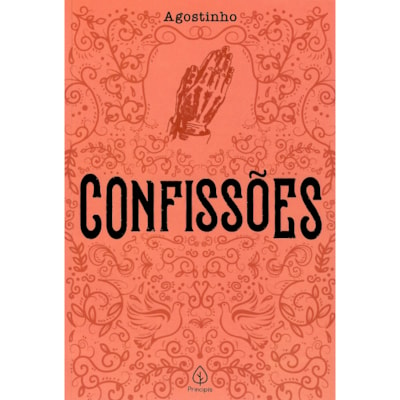

# A doutrina do pecado original: Agostinho e a concupiscência

A doutrina do pecado original teve papel central na forma como a Igreja cristã, sobretudo a partir da Idade Média, moldou as percepções e regulou as práticas sexuais, com efeitos que duram até hoje.

A seguir, uma explicação mais detalhada sobre como esse controle foi estabelecido e justificado, descrito por muitos historiadores como uma forma de manipulação para manutenção do poder. Este capítulo apresenta a doutrina e o homem que a formulou; o seguinte coloca esse homem no divã.

## A Origem: Pecado Original, Agostinho e a Concupiscência

A base para a visão da Igreja sobre o sexo foi amplamente consolidada por **Santo Agostinho de Hipona** entre os séculos IV e V. Antes dele, as visões sobre o sexo no cristianismo primitivo eram diversas. No entanto, foi Agostinho quem conectou de forma *permanente* o **pecado original** à sexualidade humana.

Em sua interpretação da queda de Adão e Eva, Agostinho argumentou que o pecado de desobediência a Deus corrompeu a natureza humana. Essa corrupção, transmitida a toda a humanidade, manifestava-se principalmente através da **concupiscência**: o desejo desordenado, especialmente o desejo sexual. Para Agostinho, *a própria ereção involuntária* era uma prova de que a carne se rebelava contra a razão, um legado direto da desobediência de Adão no Éden.

Assim, o ato sexual, *mesmo dentro do casamento*, foi associado à irracionalidade, à perda de controle e à transmissão do pecado original de geração em geração. Essa visão marcou uma virada fundamental, estabelecendo uma desconfiança profunda em relação *ao desejo* e ao prazer sexual que se enraizou nas sociedades cristãs.

Entender o contexto em que Santo Agostinho vivia é essencial para compreender as reais motivações de sua interpretação da sexualidade como algo tão danoso, e por que ele buscou com tanto afinco tais interpretações. *A análise psicanalítica dessas motivações vem no capítulo seguinte; antes, é preciso conhecer o homem e as suas ideias*.

## Primeiramente, quem foi Santo Agostinho de Hipona?

Aurélio Agostinho (354-430 d.C.), conhecido como Santo Agostinho de Hipona, é universalmente considerado um dos pensadores mais importantes e influentes da história ocidental. Atuando como uma ponte entre a filosofia clássica da antiguidade e o pensamento medieval, ele não foi apenas um bispo e teólogo, mas o arquiteto de doutrinas que se tornaram a base da teologia cristã e moldaram profundamente a cultura, a psicologia e a moralidade do Ocidente. E no decorrer desta parte do livro vamos entender por que tais doutrinas permanecem intactas mesmo que tenham se passado mais de 1.500 anos.

## Santo Agostinho e a Sua Jornada

Para entender as ideias de Agostinho, é crucial conhecer a sua vida, pois a sua filosofia é, em grande parte, *uma resposta aos seus próprios conflitos internos*. Por sorte, ele escreveu um livro em que ele próprio nos conta as suas frustrações amorosas. A sua obra mais famosa, **"Confissões"**, é uma autobiografia espiritual pungente, em que ele narra a sua jornada de uma vida de "pecado" até a conversão.

  - **Juventude Inquieta:** Nascido em Tagaste, no norte da África (atual Argélia), filho de um pai pagão, Patrício, e de uma mãe cristã *extremamente devota*, Mônica (**hoje Santa Mônica**), Agostinho era um jovem brilhante e ambicioso. Foi enviado para estudar *oratória* em Cartago, a grande metrópole da região, onde, como é normal para a idade, mergulhou numa vida de prazeres. Ele mesmo reinterpreta a sua juventude (normal) como dominada por paixões, ambição e uma busca incessante por satisfação. Durante este período, ele teve um relacionamento de longa data com uma amante (sem casamento), com quem teve um filho, Adeodato.

  - **A Busca pela Verdade:** Apesar da vida hedonista, Agostinho tinha um coração inquieto. A sua inteligência não lhe dava paz. Por volta dos 19 anos, ele buscou respostas no **Maniqueísmo**, uma religião dualista que via o mundo como um campo de batalha entre o bem (espírito) e o mal (matéria). Esta visão o atraiu por quase uma década, pois parecia explicar o mal no mundo e o absolvia da culpa pessoal, atribuindo as suas ações à **‘natureza má da carne’**.

  - **A Conversão:** Agostinho mudou-se para Roma, agora com 29 anos, abandonando o Maniqueísmo em busca de mais conhecimento, e depois para Milão, o centro do Império Romano na época. Lá, ele conheceu o influente bispo Ambrósio. A eloquência e a sabedoria de Ambrósio impressionaram Agostinho e, juntamente com as orações incessantes de sua mãe Mônica, *começaram a derrubar as suas barreiras intelectuais contra o Cristianismo*.

O clímax ocorreu em 386 d.C., aos 31 anos de idade, num famoso episódio: ele estava em um jardim em Milão, sofrendo uma crise de angústia profunda, chorando e se sentindo impotente para mudar sua vida, quando ouviu uma voz de criança dizendo **"Tolle, lege" ("Toma e lê")**.

Ele interpretou isso como um comando divino. Então, ele se levantou, foi até onde estava um livro próximo a ele, pegou-o e o **abriu em uma página aleatória**.

Ele abriu a Epístola de Paulo aos Romanos, capítulo 13, versículos 13 e 14, e leu nessa passagem algo que justamente o chamava a abandonar a "vida de devassidão".

*"Andemos honestamente, como de dia; não em glutonarias, nem em bebedeiras, nem em desonestidades, nem em dissoluções, nem em contendas e inveja.*

*Mas revesti-vos do Senhor Jesus Cristo, e não tenhais cuidado da carne em suas concupiscências."*

Naquele momento, a sua resistência desmoronou e ele se entregou à fé cristã, para felicidade de sua mãe.

Essa passagem falou diretamente à sua angústia. Ele estava em um conflito excruciante, querendo se entregar a uma vida de castidade, mas sentindo-se um "prisioneiro" de seus desejos sexuais (a "vida de devassidão" e as "concupiscências da carne" que o texto menciona).

Ao ler essas palavras, ele sentiu como se Deus estivesse lhe dando uma ordem direta e a força para cumpri-la. Em suas Confissões, ele escreve que, após ler essa frase, não sentiu necessidade de ler mais nada, e que "uma luz de segurança se infundiu em meu coração e todas as trevas da dúvida se dissiparam". Foi a resposta exata de que ele precisava para o seu conflito interno naquele momento.

## O Teólogo e as Suas Ideias Fundamentais

Após a sua conversão, a poderosa mente de Agostinho, antes a serviço da ambição por conhecimento, *voltou-se inteiramente para a teologia*. Ele retornou à África, tornou-se sacerdote e, mais tarde, Bispo de Hipona, cargo que ocupou até à sua morte. Foi nesse período que ele formulou as doutrinas que se tornaram o alicerce do pensamento cristão ocidental e o são até hoje.

1.  **Pecado Original e Concupiscência:** Esta é talvez a sua contribuição mais impactante, já apresentada no início do capítulo. O ponto a guardar é a origem dela: foi com base na ***sua própria luta com o desejo sexual*** que Agostinho transformou a desobediência de Adão em uma corrupção da própria natureza humana, *que ele chamou* de **Pecado Original**, transmitida de geração em geração através do simples ato sexual.

2.  **A Graça Divina e o Livre-Arbítrio:** Em sua famosa controvérsia com o monge Pelágio, Agostinho solidificou a doutrina da graça. Pelágio defendia que os seres humanos tinham livre-arbítrio para escolher o bem e alcançar a salvação por mérito próprio. Agostinho, partindo da sua visão da natureza humana como *irremediavelmente* danificada pelo pecado, argumentou que o livre-arbítrio estava tão enfraquecido que era impossível para uma pessoa escolher o bem sem a intervenção direta e imerecida da **Graça de Deus**. Sem a graça divina, estávamos condenados. Isso colocou a dependência total do indivíduo em Deus e, por extensão, na Igreja como dispensadora da graça através dos sacramentos.

3.  **O Nascimento Virginal: A Exceção que Cimenta a Regra do Pecado Sexual:** Um dos pilares mais poderosos na construção da culpa sexual no inconsciente coletivo cristão é a doutrina do nascimento virginal de Jesus. Este conceito funciona como um mecanismo teológico essencial que *cimenta* a associação entre o ato sexual e a impureza.

*Sem isso*, a teologia de Agostinho cria um problema fundamental: se todo ser humano herda a mancha do Pecado Original através da concupiscência (desejo da carne) inerente ao ato sexual, como poderia um Salvador nascer sem essa mesma mancha?

A **Concepção Virginal** torna-se a "cláusula de exceção" *indispensável para resolver este paradoxo*. Ao postular que Jesus foi concebido em Maria diretamente pela ação do Espírito Santo, sem a participação de semente masculina e — crucialmente — **sem o ato da concupiscência**, a teologia cria uma rota de fuga. Jesus pode ser plenamente humano, mas permanece livre da corrupção herdada, pois sua concepção contornou o mecanismo de transmissão: o sexo.

*O impacto psicológico dessa doutrina é imenso*, pois cria uma dicotomia **absoluta**:

**Concepção com sexo:** Associada à queda, à mancha, à humanidade pecadora.

**Concepção sem sexo:** Associada à pureza, à santidade, à perfeição.

A mensagem subliminar, internalizada por séculos, é que a manifestação mais elevada do sagrado só pôde ocorrer **evitando-se o ato sexual**. Isso rebaixa o sexo a um plano inferior, animalizado e intrinsecamente "sujo" ou, na melhor das hipóteses, a um *mal necessário* para a procriação da espécie caída. A figura de Maria é então elevada ao status de "Sempre Virgem", tornando-se o ideal feminino máximo. Contudo, é aqui que a análise histórica expõe a construção da doutrina. Estudos linguísticos e culturais apontam que a "virgindade" de Maria pode ser uma ilusão criada a partir de reinterpretações textuais. Por exemplo, o termo *hebraico* *almah*, usado na profecia original de Isaías, significa simplesmente "jovem mulher", sem implicar necessariamente virgindade sexual. Foi na tradução para o grego (*parthenos*) que o termo ganhou essa conotação, que foi então explorada teologicamente. Para se referir a uma virgem no sentido estrito, o hebraico bíblico dispõe de outro termo, *bethulah*. O fato de Isaías usar *almah* e não *bethulah* é um dos principais argumentos de quem defende que a profecia original não exigia uma virgem no sentido sexual: o texto hebraico de Isaías 7:14, por si só, não prova que a mulher em questão nunca havia tido relações. A ideia de virgindade física deriva de uma decisão de tradução feita séculos depois. Historiadores como Philip C. Almond e André Leonardo Chevitarese, ouvidos pela BBC News Brasil, tratam a virgindade de Maria como uma construção histórica e teológica que começa nessa tradução. E não há evidência em contrário a esperar da Igreja: obviamente nunca foi do interesse dela provar que Maria teve uma vida sexual comum.

Apesar dessas evidências, foi a **interpretação literal e biológica** que se tornou dogma. *Agostinho e a Igreja precisavam dessa literalidade para resolver o paradoxo do Pecado Original*. Ao transformar uma possível alegoria ou um matiz cultural em um fato biológico milagroso, eles criaram um ideal de mãe cujo corpo não foi "contaminado" pela experiência sexual, moldando de forma decisiva a percepção ocidental sobre o corpo e o prazer.

A partir daí, os próprios órgãos genitais passaram a ser sinônimo de impureza no Ocidente: as imagens de anjos, mesmo sem roupa, ou escondem os órgãos genitais ou simplesmente não os possuem. Outra observação é que em toda a América Latina (principalmente nela) não encontramos estátua com órgão genital à mostra, nem mesmo em representações indígenas, embora se saiba que os indígenas originalmente andavam nus. É aceitável, por exemplo, ver nádegas, mas mostrar um falo em uma estátua já é visto como ofensa, baixaria.

## A Controvérsia Agostiniana-Pelagiana: Graça vs. Livre-Arbítrio

É importante falar um pouco mais sobre esse embate, pois o apoio da Igreja ao discurso de Agostinho, e não ao de Pelágio, mudou toda a história dali por diante.

No início do século V, enquanto o Império Romano cambaleava, uma batalha intelectual feroz era travada pelo futuro da teologia cristã. De um lado, estava Aurélio Agostinho, o Bispo de Hipona, com sua visão de uma humanidade *ferida e dependente*. Do outro, Pelágio, um asceta e monge da Britânia (atual Reino Unido), *com uma visão otimista da capacidade humana*. O choque entre eles foi uma disputa sobre a questão mais fundamental: **O ser humano pode alcançar a salvação por seus próprios méritos, ou ele está irremediavelmente perdido sem a intervenção divina?**

## As Duas Visões Opostas

A disputa pode ser resumida em como cada um respondia a quatro questões-chave: o pecado de Adão, o Pecado Original, o livre-arbítrio e a graça divina.

| **Conceito**         | **A Posição de Pelágio (Otimismo Humanista)**                                                                                                                                                             | **A Posição de Agostinho (Realismo da Queda)**                                                                                                                                                       |
| -------------------- | --------------------------------------------------------------------------------------------------------------------------------------------------------------------------------------------------------- | ---------------------------------------------------------------------------------------------------------------------------------------------------------------------------------------------------- |
| **O Pecado de Adão** | O pecado de Adão prejudicou **apenas a ele mesmo**. Foi um "mau exemplo", mas não alterou a natureza humana fundamentalmente.                                                                             | O pecado de Adão foi uma catástrofe que **corrompeu a natureza humana** em sua essência, ferindo toda a sua descendência.                                                                            |
| **Pecado Original**  | **Não existe**. Os bebês nascem em um estado de inocência e neutralidade, o mesmo estado de Adão antes de pecar. Não herdamos a culpa de Adão.                                                            | **É a doutrina central**. Todos os seres humanos nascem com a mancha do Pecado Original, uma "massa de perdição" (massa peccati), herdada através da concupiscência no ato da procriação.            |
| **Livre-Arbítrio**   | A humanidade possui um **livre-arbítrio intacto e poderoso**. Temos a capacidade natural de escolher entre o bem e o mal e, portanto, de viver uma vida sem pecado se assim escolhermos.                  | O livre-arbítrio foi **severamente danificado** pela Queda. Agora, sem a ajuda de Deus, nossa vontade está "escravizada" ao pecado. Somos livres apenas para pecar.                                  |
| **Graça Divina**     | A graça de Deus é uma **ajuda externa útil**, mas não essencial. Ela ilumina e ensina (como a Lei e o exemplo de Cristo), tornando mais fácil fazer o bem, mas a decisão final e a capacidade são nossas. | A graça de Deus é uma **força interna, irresistível e absolutamente necessária**. Sem a graça para curar e mover nossa vontade, a salvação é impossível. Ela é um dom imerecido, não uma recompensa. |

## O Coração da Disputa

No fundo, a batalha era entre duas visões antropológicas:

  - **Pelágio:** Defendia a autonomia e a responsabilidade radical do indivíduo. Se Deus nos deu mandamentos, é porque temos a capacidade inata de cumpri-los.

  - **Agostinho:** Defendia a total dependência da humanidade em relação a Deus. A sua experiência pessoal de luta contra o desejo o convenceu de que a vontade humana era impotente. Para ele, a visão de Pelágio era um ato de orgulho perigoso, que negava a necessidade de Cristo como Salvador.

## O Desfecho e o Legado Duradouro

Agostinho, *com sua imensa influência e a força de seus argumentos*, venceu a disputa de forma decisiva. O Pelagianismo foi oficialmente condenado como **heresia** em vários sínodos e concílios da época, notadamente no **Concílio de Cartago (418 d.C.)**.

O legado da vitória de Agostinho foi *monumental* e **define o *Ocidente* até hoje**:

1.  **A Doutrina da Culpa:** A visão do Pecado Original como uma falha herdada e da natureza humana como fundamentalmente corrompida tornou-se a doutrina padrão. Isso inscreveu um sentimento de culpa e inadequação na psique ocidental.

2.  **O Poder da Igreja:** Ao afirmar que a salvação *é impossível* sem a graça, e que a graça é primariamente dispensada através dos sacramentos (como o batismo para lavar o Pecado Original), a posição de Agostinho fortaleceu imensamente o poder e a necessidade da instituição da Igreja como intermediária entre Deus e a humanidade.

3.  **Fundamento da Reforma Protestante:** Séculos mais tarde, reformadores como Martinho Lutero e João Calvino se consideravam verdadeiros agostinianos. Suas doutrinas de "Sola Gratia" (Somente a Graça) e a depravação total do homem são um eco direto da vitória de Agostinho sobre Pelágio.

O impacto de Agostinho é *imenso*: ele definiu a teologia católica para todo o *milênio seguinte* e, como vimos, também a dos reformadores protestantes.

Para a nossa discussão neste livro, o seu legado mais relevante foi ter **inscrito a culpa, a vergonha e a desconfiança do corpo no coração da experiência ocidental**. A sua luta pessoal com a sexualidade foi transformada numa doutrina universal que ensinou gerações a verem os seus desejos mais naturais como uma fonte de corrupção e um sinal de sua natureza caída, um ciclo de repressão e sofrimento que analisamos em detalhe nos capítulos seguintes.
