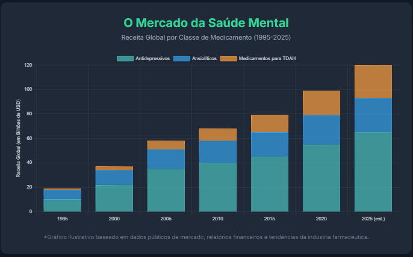

# Do confessionário à farmácia: a repressão no século XXI

*Tudo o que vimos até aqui levanta quatro perguntas:*

1.  A Igreja tinha consciência do dano que causava e usou isso como estratégia?

2.  Quando a indústria farmacêutica entrou nessa equação?

3.  Qual a relação disso com a prisão de Wilhelm Reich?

4.  Como isso se conecta ao sucesso estrondoso de estimulantes sexuais hoje em dia?

Vamos analisar cada um desses pontos.

### 1. A Intencionalidade da Igreja: Estratégia Consciente ou Consequência do Poder?

Esta é uma questão de debate histórico. É improvável que tenha existido um plano mestre, concebido "desde o princípio", com o objetivo cínico de "deixar os indivíduos doentes". A realidade é mais complexa, mas, talvez, mais perturbadora.

  - **Fase Inicial (Teologia da Pureza):** Nos primeiros séculos, o principal objetivo dos pensadores cristãos era criar uma identidade distinta da "devassidão" percebida do Império Romano. A ênfase na pureza, no ascetismo e no controle do corpo era uma forma de se posicionar como espiritualmente superior. A intenção primária era teológica: alcançar a salvação.

  - **Fase de Consolidação (Mecanismo de Controle):** A partir da Idade Média, com a Igreja já como poder dominante na Europa, a situação muda. Líderes e teólogos, como os que se reuniram no IV Concílio de Latrão (1215), certamente *perceberam* que a culpa e a confissão eram **ferramentas de poder imensuráveis**. Ao tornar a confissão obrigatória, a Igreja ganhou acesso à consciência de cada indivíduo.

  - **Consciência do Efeito:** É aqui que a intencionalidade se torna mais clara. A Igreja pode não ter dito "vamos adoecer as pessoas", mas ela entendeu perfeitamente que **um indivíduo atormentado pela culpa é um indivíduo dócil e dependente**. Um fiel que se sente *inerentemente pecador* por causa de seus desejos naturais buscará *constantemente* o perdão e a orientação da única instituição que pode absolvê-lo.

**Conclusão:** A repressão sexual não nasceu como um plano cínico para adoecer a população, mas evoluiu para se tornar a mais eficaz ferramenta de controle social e psicológico da história ocidental. A docilidade e a dependência não eram o objetivo inicial, mas se tornaram um resultado tão vantajoso para a manutenção do poder que o sistema foi reforçado e perpetuado por séculos. O estrago era uma consequência sabidamente útil.

### 2. A Indústria Farmacêutica: O Novo Sacerdote de Batina Branca

A indústria farmacêutica não criou a repressão, mas se tornou sua maior beneficiária na era moderna. *Ela herdou o indivíduo que a religião ensinou a ser doente*.

  - **Século XIX e Início do XX:** O mercado farmacêutico primitivo já se beneficiava. Tônicos "para os nervos", elixires e remédios patenteados eram vendidos para tratar a "neurastenia", a "histeria" e os "males da masturbação" — diagnósticos da época diretamente ligados à moralidade sexual repressiva.

  - **A Revolução dos Anos 1950:** Este é o ponto de virada. Com a invenção dos primeiros tranquilizantes (como a Meprobamato/Miltown) e antidepressivos, a indústria farmacêutica ofereceu uma solução nova e poderosa. Em vez de resolver o conflito interno (como propunha a psicanálise) ou buscar o perdão (como propunha a religião), agora era possível **silenciar quimicamente o sintoma**.

  - **Como Ela se Beneficia:** A indústria farmacêutica medicalizou o sofrimento que a repressão gerava. A ansiedade, a depressão e a insônia, vistas por Freud e Reich como energia reprimida, foram ***redefinidas*** como "desequilíbrios químicos". A solução não era mais a liberação, mas a medicação. Isso criou um mercado **multibilionário**, oferecendo uma solução rápida que não questiona a causa raiz do problema, *garantindo um cliente para a vida toda*.

### 3. A Prisão de Wilhelm Reich: Ameaça ao Sistema

A história de Wilhelm Reich é emblemática dessa transição.

  - **A Acusação Oficial:** Reich foi preso nos EUA nos anos 1950 não diretamente por suas teorias sexuais, mas por desacato a uma ordem judicial da FDA (justamente a agência reguladora de alimentos *e medicamentos*). A FDA o processou por vender e promover seus "acumuladores de orgone", que a agência ‘considerou’ um dispositivo médico fraudulento.

  - **A Relação com a Indústria Farmacêutica:** A perseguição a Reich foi uma tempestade perfeita. Suas ideias eram uma ameaça em múltiplas frentes:
    
    1.  **Ameaça Médica e Farmacêutica:** Ele sugeria uma cura definitiva para neuroses baseada na liberação da energia corporal e sexual, **sem o uso de medicamentos**. Isso o colocava em rota de colisão direta com o modelo médico-farmacêutico na época emergente.
    
    2.  **Ameaça Política e Social:** Nos EUA da Guerra Fria e do Macartismo, as ideias de Reich sobre liberação sexual e suas ligações passadas com o comunismo eram vistas como profundamente subversivas.
    
    3.  **Ameaça à Moralidade:** Ele atacava diretamente a família patriarcal e a moralidade sexual repressiva, as bases da sociedade da época.

O sistema como um todo — médico, político e social — se uniu para silenciar uma voz que oferecia uma solução radicalmente diferente e não lucrativa para o sofrimento que eles estavam na época aprendendo a gerenciar *e monetizar*.

### 4. A Repressão e a Explosão do Tadalafila/Viagra

1.  **A Conexão Fisiológica:** A culpa sexual, a ansiedade de desempenho e o estresse crônico (gerados pela repressão) *são fatores que levam à diminuição dos níveis de testosterona* e à disfunção erétil psicogênica. *A mente, ensinada por séculos que o sexo é perigoso e sujo, **sabota o corpo.***

2.  **A Solução Farmacêutica:** Entram em cena o Viagra (Sildenafila, 1998) e o Cialis (Tadalafila, 2003). Eles são uma solução puramente mecânica para um problema psicofísico complexo. Eles não resolvem a culpa, a ansiedade ou a baixa testosterona. Eles simplesmente forçam uma resposta fisiológica contornando o bloqueio psicológico.

3.  **O Crescimento do Mercado:** O crescimento deste mercado é bem expressivo. No Brasil, o Tadalafila (especialmente após a quebra da patente) se tornou um dos medicamentos *mais vendidos* em número de unidades, muitas vezes superando analgésicos e anti-hipertensivos.

## Visualizando o Gráfico de Vendas (Descrição):

  - **1995-1997:** A linha está em zero. O tratamento para disfunção erétil era com métodos invasivos (injeções, próteses).

  - **1998:** Um pico vertical surge com o lançamento do Viagra. O "milagre da pílula azul" cria um mercado do nada.

  - **1998-2003:** A linha se mantém em um patamar muito alto, com crescimento constante.

  - **2003 em diante:** Com a chegada do Cialis/Tadalafila (e seu marketing focado no uso diário e "espontaneidade"), a linha sobe ainda mais.

  - **Pós-2010:** Com a quebra das patentes e a popularização dos genéricos, o preço cai drasticamente. A linha de vendas (em unidades) dispara para a estratosfera e se torna uma das mais altas de toda a indústria farmacêutica.

Ainda falando de estimulante sexual e trazendo dados apenas do Brasil, a Sociedade Brasileira de Urologia estima que cerca de 50% dos homens acima de 40 anos têm algum grau de disfunção erétil, algo em torno de 16 milhões de homens. Como eu também tenho contato com médicos, os relatos que eles me passam são bem complicados.

## O Brasil é um dos maiores mercados do mundo para esses medicamentos.

  - **Tadalafila:** Em 2015 foram vendidas pouco mais de 3,2 milhões de unidades no Brasil. Em 2024 foram 64,7 milhões, quase vinte vezes mais. Segundo a Anvisa, as vendas saltaram de 21,4 milhões de caixas em 2020 para 47,2 milhões em 2023.

  - **Sildenafila (Viagra e genéricos):** Só em genéricos, foram 43,7 milhões de unidades em 2024.

  - **Total:** Somando apenas os genéricos das duas substâncias, são mais de **105 milhões de caixas** vendidas em um único ano no Brasil, segundo o levantamento da IQVIA divulgado pela PróGenéricos. Em 2024 a tadalafila foi o quinto genérico mais vendido do país, à frente de remédios para pressão alta.

*Mas por que justamente o Brasil é um dos maiores mercados? Vamos novamente fazer uma análise psicanalítica e comportamental do que acontece por aqui:*

A causa raiz do alto consumo de estimulantes sexuais *não é a falta de desejo*, mas uma libido bloqueada pela **culpa**. O Brasil, em particular, emerge como um estudo de caso proeminente, em que fatores históricos, religiosos e culturais convergem para criar um ambiente psicologicamente *hostil à expressão sexual saudável*. A seguir, uma análise de quatro eixos fundamentais que constroem essa arquitetura da culpa, agora regionalizada.

### 1. O Bombardeio Simbólico: A Inscrição da Culpa no Corpo e no Ambiente

A paisagem física e social brasileira está saturada por uma iconografia cristã que opera como um mecanismo de *reforço contínuo* do Superego coletivo. A enorme profusão de igrejas em centros urbanos é apenas o aspecto mais visível. O fenômeno se estende ao nível pessoal através do uso massivo de símbolos como colares de cruz e, de forma mais permanente, tatuagens de temática religiosa.

Essas inscrições corporais são de uma riqueza simbólica imensa. Por exemplo, uma imagem como a de um leão — arquétipo da força, virilidade e poder instintivo — subjugado por uma cruz na testa, ou a imagem do calvário no antebraço, representa a narrativa internalizada de que a pulsão natural (o leão) deve ser domada e controlada pelo dogma do sacrifício. Da mesma forma, tatuagens de cruzes sobre o peito ou de anjos funcionam como uma declaração permanente de que o corpo e suas paixões estão sob a jurisdição do sagrado, da renúncia e da expiação. Longe de serem meros adornos, esses símbolos funcionam como lembretes constantes de uma identidade de "pecador". Somado à paisagem social recheada de igrejas e cruzes, isso acaba gerando uma **vigilância interna** constante que coloca o indivíduo em um estado de conflito *perpétuo* com seus próprios impulsos.

### 2. A Linguagem do Corpo: A Recusa Psicossomática da Maturidade e a Dificuldade em Amadurecer

A linguagem psicossomática revela conflitos que a mente consciente muitas vezes nega. Certas tendências culturais, embora justificadas por razões estéticas ou higiênicas, podem carregar um profundo significado de *recuo* diante da sexualidade *adulta*.

A prática generalizada da depilação íntima masculina, por exemplo, quando interpretada pela linguagem corporal, traz o seguinte contexto: os pelos pubianos são um marcador biológico da *maturidade sexual*, um elo com a nossa herança instintiva. Sua remoção sistemática pode representar uma tentativa inconsciente de retornar a um estado pré-púbere, **percebido, portanto, como "puro"** conforme a cultura do pecado original, pois apenas crianças seriam puras, e, neste caso, livres do conflito e da culpa associados à vida sexual. Da mesma forma, mudanças em posturas *arquetipicamente masculinas* podem sinalizar uma tentativa de recuo da energia. Embora a ciência convencional não trace uma causalidade bioquímica direta, o princípio psicossomático sustenta que a mente e o corpo estão interligados. Uma psique que emite sinais contínuos de *recusa da maturidade sexual* e de *contenção da energia vital* pode, a longo prazo, influenciar o sistema endócrino a espelhar esse estado de conflito. Dentre as consequências que a psicanalise mais trabalha estão as questões mentais como crises de ansiedade, depressão, e transtornos de diversos tipos. Vindo para a psicossomática voltamos as disfunções erétil e ao consumo de estimulantes sexuais visto que em um momento é desejado uma virilidade sexual que em outro momento foi considerada impura, suja, maldosa um paradoxo mental que cobra um alto preço.

A este cenário se soma um fator psicodinâmico crucial *na cultura brasileira*: **a figura da mãe superprotetora**. Em um ambiente que frequentemente idealiza o amor materno como sacrificial e incondicional, muitas mães, de forma inconsciente, podem dificultar o processo de separação psicológica de seus filhos. Ao mantê-los em um estado de dependência afetiva e funcional, elas os infantilizam, protegendo-os dos "perigos" do mundo adulto, incluindo a sexualidade. O homem permanece um *"puer aeternus"* (eterno menino), que teme "trair" ou abandonar a figura materna para se aventurar na intimidade com outra mulher, o que gera um profundo conflito de lealdade que pode paralisar a libido. Vejam que este conflito também aconteceu com Agostinho.

### 3. A Nova Ascese: A Guerra Digital Contra a Masturbação

A repressão sexual *se modernizou*, migrando dos púlpitos para as plataformas digitais. O que Wilhelm Reich demonstrou diversas vezes clinicamente — que a resolução da culpa em torno da masturbação pode aliviar neuroses e sintomas físicos — é hoje diretamente combatido por movimentos online como o "NoFap".

Esses movimentos cooptam a linguagem do autodesenvolvimento e da performance para rotular um ato *fisiológico natural* como um "vício", ou ainda como uma "perda de energia vital" e a causa de fracassos pessoais. Neste caso vale alegar tudo, a fim de proibir esse ato ‘pecaminoso’ através do medo e da culpa. A mensagem, com enorme apelo entre jovens e adolescentes, *instala a culpa em uma fase crítica do desenvolvimento psicossexual*.

Nisso, o ato de autodescoberta e de liberação de tensão é *ressignificado* como uma falha moral, criando a base para a futura ansiedade de desempenho e disfunção. A popularidade massiva de vídeos que condenam a prática demonstra a escala com que essa nova forma de moralismo ascético se infiltra na psique coletiva, perpetuando o ciclo de repressão que Reich identificou como a origem da "couraça" neurótica.

### 4. O Paradoxo do Estímulo: A Demonização da Pornografia

A dinâmica em torno da pornografia na sociedade atual revela uma armadilha psicológica perfeita. Uma cultura que reprime a expressão sexual saudável e espontânea cria um vácuo que, **paradoxalmente**, demanda estímulos externos *cada vez mais intensos* para que a excitação possa superar as barreiras internas da culpa e da ansiedade. A pornografia online, com sua acessibilidade e variedade ilimitadas, preenche esse vácuo de forma eficaz.

O paradoxo se fecha quando essa mesma cultura demoniza o indivíduo por consumir o estímulo **que ela mesma tornou psicologicamente necessário**. O problema fundamental não reside no estímulo visual em si — uma evolução tecnológica de formas mais antigas de erotismo —, mas na **relação de culpa** que se estabelece com ele. Quando o ato de buscar um estímulo sexual é carregado de vergonha e julgamento moral, o cérebro aprende a associar o desejo e a excitação à angústia. Essa associação é a via direta para o bloqueio da libido, a disfunção erétil e a consequente busca por uma solução química, completando o ciclo de neurotização e medicalização do desejo.

## E a Questão tão falada do vício em masturbação e pornografia?

Precisamos analisar isso com seriedade, em vez de buscar vídeos rápidos e fáceis de youtubers ou neurocientistas. Segue uma explicação psicanalítica deste processo:

1.  **Acúmulo de Tensão (Libido):** O corpo e a psique acumulam uma tensão *natural*, uma energia vital que busca descarga. Em um sistema saudável, como o que Reich descrevia, essa energia seria descarregada de forma plena e satisfatória, levando a um estado de relaxamento e vitalidade. Vejam a tensão libidinal como qualquer outra vontade *do corpo*, como a de se alimentar, dormir, beber água, ir ao banheiro. A diferença é que esta necessidade é desenvolvida apenas após a puberdade.

2.  **O Ato de Descarga:** A masturbação, em sua essência, *é um ato fisiológico neutro*. É o mecanismo mais simples e acessível do corpo para realizar essa descarga de tensão. O corpo armazena muita energia para fins de sobrevivência e emergência; a descarga sexual serve para eliminar o excesso. Por isso, em um processo saudável e sem culpa, o orgasmo gera um enorme relaxamento, assim como as demais necessidades citadas também o geram.

3.  **A Injeção do Veneno (A Culpa):** Aqui entra o problema. Imediatamente após o alívio momentâneo, o "Superego" (a instância moral internalizada, carregada de dogmas religiosos e sociais) ataca violentamente. A mente é inundada com pensamentos de "isso é errado", "sou sujo", "sou fraco", "sou um pecador".

4.  **Criação de uma Nova Tensão:** Essa onda de culpa e autodepreciação gera uma **nova tensão psicológica**, muitas vezes *mais insuportável* que a tensão sexual original. *É uma angústia existencial*.

5.  **A Busca Compulsiva por Alívio:** Para anestesiar essa nova e terrível dor (a dor da culpa), a psique busca refúgio no único mecanismo de alívio rápido que conhece: o ato de descarga original. A pessoa já não vê um filme e se masturba por prazer ou para liberar uma tensão natural; ela o faz para **tentar silenciar a dor da culpa gerada pela masturbação anterior.**

É um circuito de retroalimentação perfeito. A "cura" se torna a causa da doença. O ato deixa de ser sobre prazer e passa a ser sobre a tentativa desesperada de anestesiar o sofrimento. Isso é a definição de um vício. Sem a culpa, o ato seria apenas um evento fisiológico que termina em si mesmo. Com a culpa, ele se torna o motor de um *ciclo infinito de sofrimento e compulsão*.

## A linha do tempo é clara e trágica.

1.  A religião cria um sistema de **culpa sexual** que gera indivíduos psicologicamente conflituosos.

2.  Essa repressão causa **disfunções físicas** reais (ansiedade, baixa hormonal, disfunção erétil).

3.  A indústria farmacêutica surge e oferece uma **solução química** que mascara o sintoma, sem curar a causa.

4.  O resultado é uma população que continua mentalmente reprimida, mas agora quimicamente funcional, *criando um dos mercados mais lucrativos do planeta*.

O homem que antes se ajoelhava no confessionário buscando alívio para a culpa, hoje vai ao balcão da farmácia buscando uma pílula para superar o efeito fisiológico dessa mesma culpa. O agente de controle mudou, mas o ciclo de repressão e dependência continua perfeitamente intacto.

*Para elucidar o impacto da repressão sexual nos problemas mentais, trago um gráfico ilustrativo do crescimento do mercado mundial destes medicamentos (acima).*
